# Codex Minigame Pilot

**One clear next step for Motherlode Mine, Blast Furnace, Mahogany Homes, Guardians of the Rift, Tempoross, the Giants' Foundry, Mastering Mixology, Vale Totems, the Tithe Farm, stealing artefacts, stealing valuables and the Rogues' Den maze.** The Pilot watches the minigame you are in and always shows the single thing to do next: what to click, lit in gold in the world, the path there drawn on the ground and the minimap, and a line on why. You still do every click. It only reads the game and draws.

It is part of the **Codex** suite of RuneLite plugins and shares their look: warm ink, aged gold and the game's own fonts.

<p align="center">
  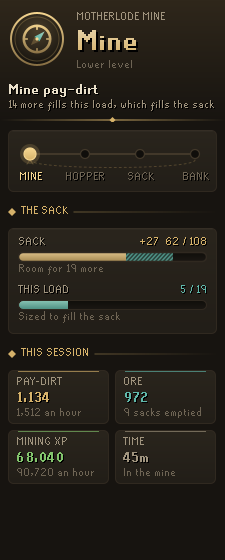
  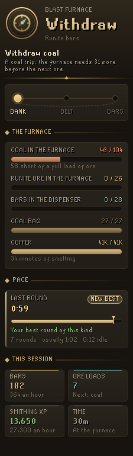
  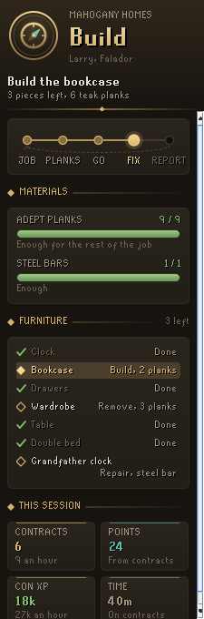
</p>

## What it does

### Motherlode Mine
- **Every load sized to fill the sack.** With 89 pay-dirt in the sack it says to mine 19, not 27 the hopper cannot take. Pay-dirt still washing through the wheel is counted as in flight, so the sack is never overfilled by a load that has not landed yet.
- **Fill, then empty.** It remembers whether you are filling the sack or emptying it, so after banking it sends you back to the sack, not the veins, until the sack is empty.
- **The nearest vein on foot.** Distances are walked over the game's own collision map, so a vein around a corner beats one behind a wall. Veins with another player standing at them count as further away. The next vein after this one is quietly outlined too.
- **Rockfalls and struts.** When the quickest way runs through a rockfall, the step becomes mining it. When both struts are broken and pay-dirt is held up, the step is hammering one.
- **Either level.** It tells the upper and lower levels apart, keeps the vein, hopper and next vein on the level you are on, and sends you to the ladder when what you need is on the other. The upper level needs 57 Mining and a nugget unlock, and its hopper is a second unlock, so it only sends you up the ladder once you have 57 Mining and have been up there, and only offers the upper hopper once you have used it, or straight away if you turn on Upper hopper unlocked.
- **What the sack pays.** Every ore the sack hands you is counted and priced at today's Grand Exchange prices, with coins an hour beside your experience. Only what comes out of the sack counts, not ore taken from the bank. With an open coal bag the sack's coal goes straight into the bag; the sack says how many pieces it gave, so what never reached your pack is counted as coal in the bag.

### Blast Furnace
- **Coal trips worked out ahead.** At the bank it compares the coal in the furnace, plus a full coal bag, with what a load of ore will burn, and calls a coal trip only when the ore would otherwise sit unsmelted. Steel with a coal bag never needs one, mithril needs one every other ore trip, and runite about one and a half to each ore trip.
- **The whole round.** Deposit bars, fill the coal bag, withdraw coal or ore (ringed in the bank), load the belt, empty the coal bag and load again, put on ice gloves while the bars smelt, take them, bank. Gold asks for goldsmith gauntlets before the ore goes on the belt.
- **Coffer watch.** It asks you to top up the coffer before it runs dry, and the panel shows how many minutes of smelting are left.
- **Any bar.** Iron, steel, mithril, adamantite, runite, gold and silver, picked from the ore you carry, the ore in the furnace or the ore in your bank, or chosen in the settings.
- **How far your bank goes.** The ore and coal in your bank, with what you carry, the coal bag and the furnace, turned into bars, trips and time at your own trip pace, and which runs out first: "975 runite bars, 92 trips, about 1h 38m. Coal runs out first: 1,060 more would smelt all the ore".

### Mahogany Homes
- **From contract to points.** Which contractor to ask and for which tier, the planks and steel bars to bring (counted from the job's own furniture, plank sack included), the way to the client's house with a hint arrow and a world map marker, the teleport you carry that gets there quickest, then each piece of furniture in walking order.
- **The tier your planks can finish.** The best tier your level reaches, unless its planks (bank, pack and sack) would not finish a contract and a lower tier's would: "Not enough mahogany planks for an expert contract; your teak planks cover at least 9 contracts". Contracts cannot be cancelled, so until you have finished one of a tier it counts a contract as the most any can take (every piece in the largest house, 17 planks), then as what yours have taken.
- **The quickest way there, door to door.** With Codex Wayfinder installed, every teleport you own is weighed, cast and walk, at your own walking pace, against walking from where you stand: "Falador tablet, about 25s. Ring of wealth in your bank: 15s". Without it, the teleport you carry for the city, or the one the wiki recommends.
- **Repairs apart from rebuilds.** Furniture one click mends is outlined in teal, and what you take out and build in gold, so you can see at a glance what is one action and what is two.
- **The plank sack's fill.** A gauge of the sack against its 28, by wood, and when you are short of planks the step says how much room the sack still has.
- **Every contract kept.** Each contract you hand in is kept per account with its client, tier, experience and loop time, and the panel shows your last five, the quickest of each tier ticked, with your points an hour. After a hand-in, when the planks left cover fewer than two more contracts, the chat says so (*Low planks in chat*).
- **Floor by floor.** When the rest of the work, or the client, is upstairs, the step is the ladder.
- **A checklist.** Every piece of furniture with what it needs (repair, remove, build) and what it costs, ticked off as you go.
- **What a contract costs you.** Each contract you finish is measured: the Construction experience it gave (any outfit bonus included), the planks and steel the job took, and the whole loop's time. Priced at today's Grand Exchange prices, the tiers you have done are ranked by coins per experience point, with experience an hour, so you can see whether expert contracts are worth their mahogany. Nothing is guessed: a tier is ranked once you have finished one, and a job first seen half done is not measured.
- **Planks in the bank.** Your tier's planks and steel bars in the bank, carried and in the plank sack, counted in contracts at what your own contracts take, and in time: "Mahogany planks for about 24 contracts, 1h 48m". Away from the minigames the Mahogany Homes card says the same.

<p align="center">
  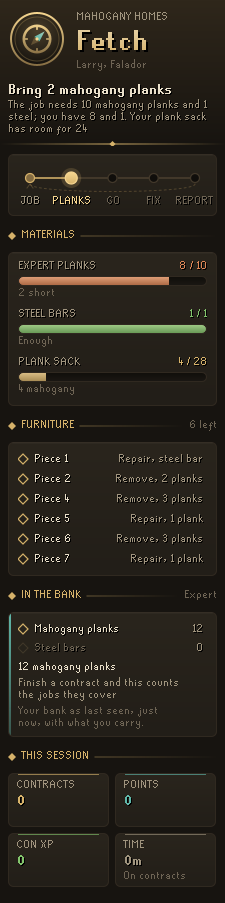
  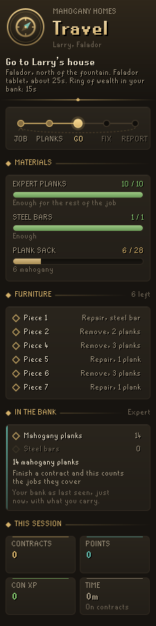
  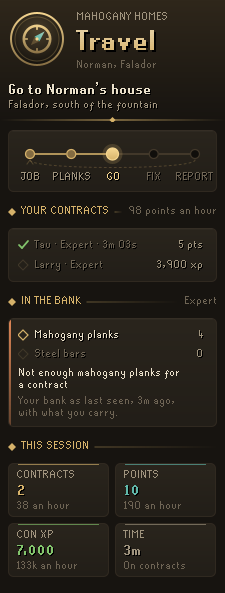
</p>

### Guardians of the Rift
- **One step through the whole game.** Take uncharged cells, wait for the rift, mine fragments, craft essence at the workbench, fill your pouches, enter the altar, craft, empty the pouches and craft again, take the portal back, power up the Great Guardian with your stones, place the charged cell, deposit the runes, and round again. Each one is lit in the world with its path and a line of why.
- **Fragments sized to the trip.** At the start of a game it mines to 120 fragments before the first craft, as the wiki's general strategy does (a setting). After that it mines only what one trip needs: the free slots in your pack and the room in your pouches, read from the pouches themselves.
- **The right altar for you, not just the open one.** Of the two open altars it never picks one your Runecraft level or your quests shut you out of (cosmic needs Lost City, law Troll Stronghold, death Mourning's End Part II, blood Sins of the Father), and it says so: "The death altar is not yours yet". Of those you can use it follows the wiki's rule for even points: blood and death first, then fire and earth, otherwise the type you have fewer points of.
- **Your points, kept even.** It reads your elemental and catalytic points when you check the Rewards Guardian and from the totals at the end of each game, takes one of each off for every search, and adds what this game's energy is worth so far. The panel shows both in whole points, as the game reports them, with what this game's energy will add (every 100 energy is a point, and the rest is a chance of one more), the searches they pay for, and which one runs out first. Until it has seen your points it says so rather than guessing, and picks the stronger cell instead.
- **The rift's clock.** How long the rift has been open, the guardian's power, and when the next portal to the huge guardian remains is about due (the first about 160 seconds in, then every 140, as the wiki has it). When that portal is open and your trip still needs essence, the step is to take it.

### Giants' Foundry
- **The right tool at the right heat.** Each stage of the sword asks for one machine, and each machine for one heat: the trip hammer hot, the grindstone medium, the polishing wheel cold. The step is always the one that fits: the machine when the sword is in its band, the lava pool when it is too cold, the waterfall when it is too hot. Far off the band it says dunk or quench, the fast options; close to it, heat or cool, to fine-tune, as the wiki's strategies advise, and where to stop: near the top of the band for the hammer and the wheel, which cool the sword as you work, near the bottom for the grindstone, which heats it.
- **How long the heat lasts.** In the band, the step counts the uses its heat is good for (the hammer takes 2.5% a strike, the grindstone adds 1.5%, the wheel takes 1.7%) against the uses still needed to finish the stage, and names the next stage's machine and heat when this one is about to end. A sweet spot turns the step into "use it now".
- **The best moulds you own.** For Kovac's commission, the forte, blade and tip with the highest score for its two words, ringed in the mould jig's list. It learns which moulds you have bought from the jig itself, checks that against the count the game keeps, and until the two agree it sets only what it is sure you own and says so. It also names the mould worth buying next: the one at your level that adds most to your mould score across all fourteen commissions, for each point of reputation it costs.
- **The whole sword.** Commission, moulds, 28 bars' worth in the crucible (with its metal score and how many sections that makes), pour, lift the preform (a bucket of water or ice gloves), each stage, and the hand-in. A sword set down in storage, or too damaged to finish, is picked up from there.
- **Your swords, kept.** Each sword's quality (the reputation it paid), the Smithing experience Kovac gave and the time from commission to hand-in, kept per account. Across them, reputation and experience an hour, and your best sword, judged as the game does: highest quality, then quickest.

<p align="center">
  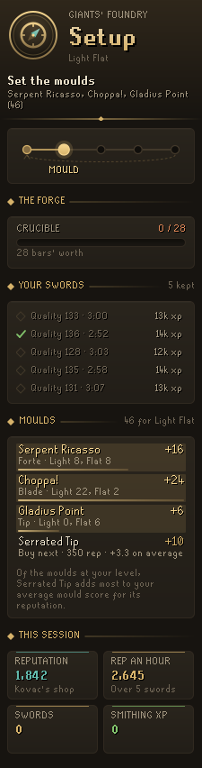
  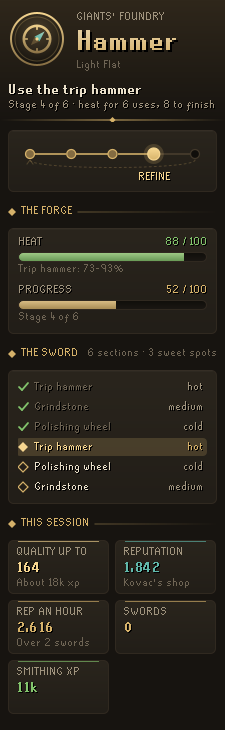
</p>
<p align="center">
  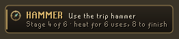
  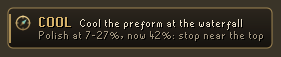
</p>

### Mastering Mixology
- **The orders your paste can fill.** Of the three open orders it makes every one the hopper has paste for, as the wiki's strategies advise (all three in one deposit pay 40% more resin, two 20% more). Short of a paste, it keeps the orders that pay the most resin and says why the others are left ("short of lye"). Or, under *Mixology orders to make*, the most resin per paste: mammoth-might mix, alco-augmentator and liplack liquor are skipped unless a mixalot is ordered.
- **The levers, one pull at a time.** Each potion's paste in its recipe's order, counting what is already in the vessel, and when the vessel holds paste for another order that one is mixed first so no pull is wasted. Paste that fits no order means pulling all three again, which costs nothing.
- **The right station, and its cue.** Potions are worked at the station their order names, the alembic first, then the retort, then the agitator, as the wiki's strategies go. At the retort it says to keep clicking; at the agitator and the alembic the step turns into "Click the agitator now" the moment its quick action is live, for the two ticks the agitator gives (*Mixology station cues*). Then the conveyor belt.
- **Digweed where it pays.** A digweed in a corner is picked, then used on the mixalot (below 81 Herblore, on the ordered potion with the most experience), never on the three single-paste potions.
- **What to put in the hopper.** The hopper's three pastes in orders' worth at your level (the wiki: at 75, mox, aga and lye are ordered about 39:35:31), the one that runs out first, and the herb that makes it cheapest at today's Grand Exchange prices. Short of paste, the step is the hopper (paste carried), the refiner (herbs carried) or the bank.
- **Resin towards a reward.** Pick a reward under *Mixology reward*: your mox, aga and lye against its price, and how long it is at your own pace.
- **Every delivery kept.** Each delivery's resin, the Herblore experience over the round and its time, per account. Across them, resin and experience an hour and your best round.

<p align="center">
  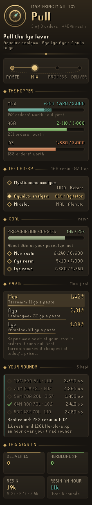
  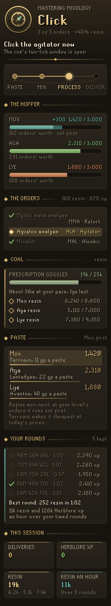
</p>
<p align="center">
  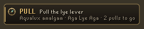
  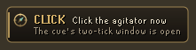
</p>

### Vale Totems
- **The next site and what to bring.** At an empty site it builds with the best logs you carry that your Fletching allows (boosts count, as the wiki says), or the wood you pick under *Vale totem wood*. Then on to the next site with work: the one you usually go to next, which the Pilot learns from your own loops, else the nearest. Each site's place is learnt as it comes into view and kept, so a site out of sight gets the hint arrow and a world map marker. With no logs, the step is the bank, for the best logs your level builds; the panel says what the rest of the loop takes: "Loop: 5 logs, 26 decorations".
- **The three spirits, ringed.** Each site wants three of the five spirits (buffalo, jaguar, eagle, snake and scorpion), and each wrong carving costs a quarter of the decoration experience. The step names the next one, and when the game's carving choices are open the right ones are ringed in gold, read by the icons the game draws in them. For the last carving it passes on the wiki's tip: finish it once a visiting ent's animation ends.
- **Decorations of the totem's own wood.** Four fletched items of the totem's wood finish it (any of its bows, strung or not, a shield or a stock; redwood shields or hiking staves), read from the totem the site shows. Carrying logs and a knife but no decorations, the step is to fletch them.
- **Offerings, claimed as you pass.** The offerings waiting at each site, and claiming them before you move on (*Claim offerings as you pass*), or only when 15,000 of them stop you building there. The panel lists all eight sites: wood, carved or decorated, and offerings.
- **Ent trails.** Trails near you are outlined quietly while no trail bonus is under way; once it is, a gauge counts the bonus.
- **Research points towards a reward.** Pick one under *Vale Totems reward* (ent branch, bow string spool, fletching knife or greenman mask): your points, with the offerings you hold and the ones waiting at your sites at a hundred a point, against its price, and how long it is at your own pace.
- **Every totem kept.** Each totem you finish is kept per account with its wood, the Fletching experience since the one before, the offerings the ents left meanwhile and the time; across them, experience, offerings and research points an hour and your quickest totem. A world hop or logout is no ent visit: counts that arrive with a login are a new base, not offerings.

<p align="center">
  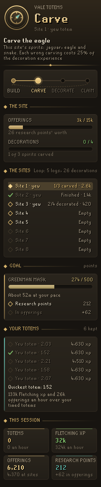
  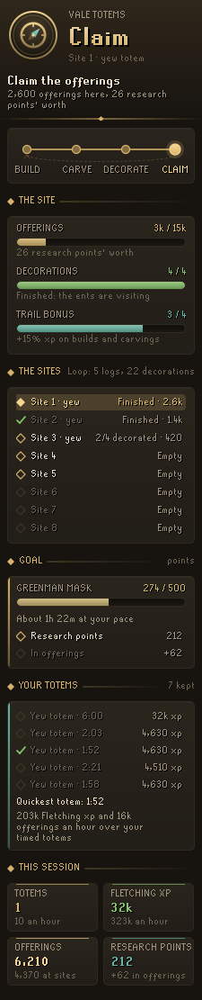
</p>
<p align="center">
  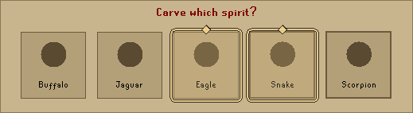
</p>
<p align="center">
  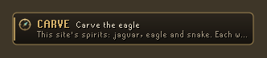
</p>

### Tithe Farm
- **The seed your Farming grows.** At the seed table it asks for the best of golovanova (34), bologano (54) and logavano (74) that your level reaches, boosts counted, and says what a sack of a hundred gives: "Your Farming (80) grows logavano, from 74: 37k xp a sack of 100". Lower seeds in your pack are named as giving less. Then full cans for your round, and the door.
- **One patch at a time, read from the patches.** Every tithe patch shows what it needs in the object the game draws: empty, a seedling or plant dry or watered at each of its three stages, grown, or blighted. The step is always one patch, lit in gold: plant the next of your round, water each seed as soon as it is in ("Plant and water on the first round"), then round again for its second and third watering, harvest what has grown (grown plants cannot die, so water comes first), clear what blighted, and deposit the fruit before the next round.
- **Before its minute runs out.** Each stage lasts a minute, and a plant left dry dies when it ends. The Pilot times each stage from the moment the patch changes, says how long a plant has ("Only 0:13 left before it wilts"), and puts a plant with fifteen seconds left first, wherever it is in your round. With every plant watered it says which one needs water next and when.
- **Your route.** A round is sized as the wiki's strategies do (*Tithe plants a round*: 16, 20, 23 or 25), and never more than your seeds or your water cover: three doses a plant. The first round goes patch to nearest patch; the order you actually plant in is kept per account as your route, and every round after follows it.
- **The farm on the panel.** A map of the patches as they lie, coloured by what each needs (water, wilting, watered, grown), numbered in your round's order with the next ringed and the patches still to plant dashed, and where you stand.
- **Water and the sack.** Doses in your cans (or Gricoller's can) against what the round still needs, and the sack's fill with the points in it: a point for every three fruit and two more at the hundredth.
- **Points towards a reward, and every sack kept.** Pick one under *Tithe Farm reward* (the farmer's outfit or a piece of it, Gricoller's can, the seed box or the herb sack): your points against its price, less the pieces you already own, with the time and sacks it is at your own pace. Each sack of a hundred is kept per account with its seed, points, Farming experience and time from first seed to last deposit; a sack begun when you leave, hop or log out is kept as it stood, since leaving resets the farm's game.

<p align="center">
  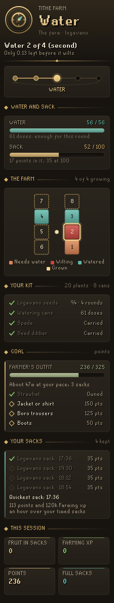
  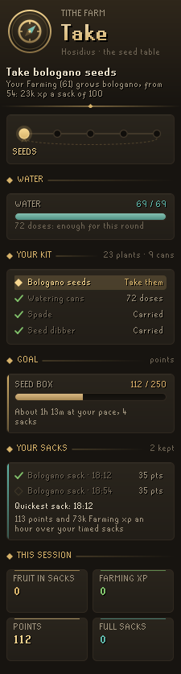
</p>
<p align="center">
  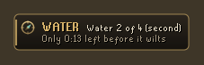
</p>

### Stealing artefacts
- **The house Captain Khaled names.** The task is read from the game (the varbit RuneLite calls `PISCARILIUS_BURGLARY_TARGET`) and from Khaled's own words when he gives it ("It can be found in the..."). Which varbit value is which house is not on the wiki, so where his words and the varbit disagree, his words win and the panel says so. The varbit values and where each house stands are as the [Stealing Artefacts](https://github.com/pajlads/StealingArtefacts) plugin (MIT) has them, re-implemented rather than copied; each drawer's place is replaced by the game's own once it comes into view.
- **Ladder, drawers, and back down.** Only the north house keeps its drawer on the ground floor; in the others the step is the house's ladder, then the drawers (lit gold, *Pick-lock*), then the ladder down. Upstairs in the wrong house, it says so. A house out of sight gets the hint arrow and a world map marker, pointed where its drawers were last seen.
- **On foot, clear of the patrols.** With an artefact the step is Captain Khaled, walked to on foot: the wiki says a teleport, a logout or a random event loses it, so a teleport book you carry is flagged "not until the hand-in". The patrols near you are outlined in ember with a wedge on the ground the way each faces (*Mark patrols*), and the step says when the nearest one is facing you.
- **The district on the panel.** The six houses as they lie, the task's lit, the patrols with their facing, Khaled (or an arrow his way) and you.
- **Every artefact kept.** Each trip, from the task to the hand-in, is kept per account with its house, Thieving experience, Khaled's coins and time, or as lost when it never reached him. The panel shows artefacts, experience and coins an hour at your own pace, against the wiki's 48 an hour, your quickest trip, and your average to each house beside the wiki's.
- **A Thieving level, and the diary.** Your next level (or the one under *Stealing artefacts level*) in artefacts at 750 and 40 times your level each, and in time at your pace, with the Kourend & Kebos hard diary task (deliver an artefact) ticked once you have.

<p align="center">
  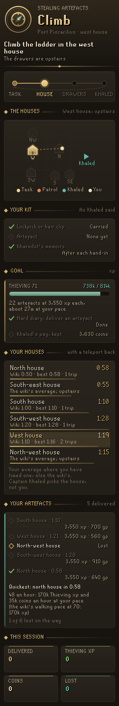
  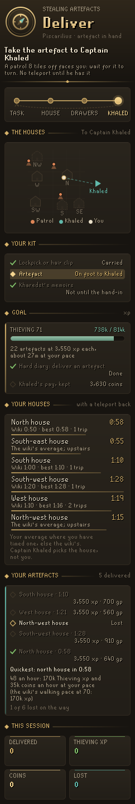
</p>
<p align="center">
  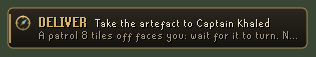
</p>

### Stealing valuables (Civitas illa Fortis house thieving)
- **The distracted citizen, then the keys.** When the game says *"You notice an urchin distract a wealthy citizen nearby."* the step is that citizen, lit gold: the wiki says every pick succeeds for about twenty seconds. The citizen is the one the urchin is interacting with, else the one beside it, as the wiki names no marker. Between distractions the panel counts down to the next (the wiki's 84 to 99 seconds) and says when to wait by the citizens instead.
- **The vacant house, when it is safe.** Only one house is vacant at a time and its door is a *Locked Door*. The Pilot names it by its owner (Lavinia, Victor or Caius, learned from who stands by each door), waits while the owner is still about the door (the game turns you back), and from the moment it saw the door lock counts the wiki's 180 to 190 seconds until the owner is back. A house with too little time left is not worth a key; an urchin can tell you the next for 15 valuables.
- **Inside: search, then the window.** The step is the nearest chest, wardrobe or jewellery case, then "keep searching" while valuables come, the flashing arrow when something shines (14 valuables and 630 xp, gone in about seven seconds), and the open window (the way out the wiki gives) as soon as the owner may be back or the whistle sounds: caught inside, about 90% of the house's valuables go. The windows are marked quietly all the while, and the owner near you is outlined in ember (*Mark homeowners*).
- **Every haul kept and valued.** Each house is kept per account: its owner, time inside, valuables taken and kept (a catch shows as "Caught: 11 of 109"), jewellery and anything else at RuneLite's Grand Exchange prices, and the experience of the house and of the whole round since the last one, pickpocketing included. Valuables are valued at what Oriana pays you: 55, until a trade-in shows she pays you 65 (Gladiator rank). The panel shows coins and experience an hour at your own pace beside the wiki's, your best haul, your average at each house, and a Thieving level in valuables and time (*Stealing valuables level*).

<p align="center">
  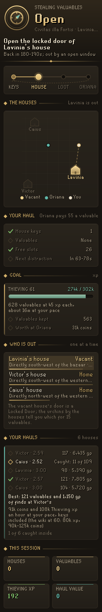
  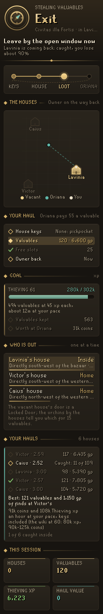
</p>
<p align="center">
  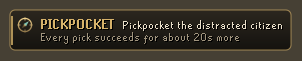
  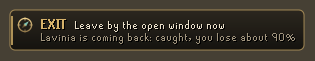
</p>

### Rogues' Den
- **One leg of the maze at a time.** The wiki's way through, row by row: the contortion bars and pendulum, the stairs to the north-west gate, the trap line, either of the two ledges, a blade to left-click (or you walk round it), the pendulums and the ledge, the trap room; then, under 80 Thieving, the long route (passageways, "Search wall" on the first of four walls, the tile, the mosaic door, the grills, the three walls, the pendulum), or with 80 the locked doors' shortcut; then the spinning blades, the flash powder for the guard, the last two pendulums and a wall safe. The leg's obstacle is lit in gold as it comes into view.
- **Where you are, read from the maze.** No tile of the maze is written in. The Pilot follows each run from what the game reports: the mystic jewel arriving as you enter and leaving with you, each drain of Agility at an obstacle (bars 5, pendulums 3, ledges 4, blades 3, as the wiki has them) or of Thieving at a searched trap, the tile and the flash powder in your pack, and the obstacles that stand in one room only (the mosaic door, the grills, the guard, the safes) coming near.
- **The right choice where the maze has one.** Only the item called Tile opens the mosaic door: carrying one of the three called Tiles, the step is to drop it and take the south-eastern one. The flash powder before the guard, the guard lit while you hold it. Below 6 Agility before the last two pendulums it warns you; at the safe it says the crack rolls on your drained Thieving.
- **Traps marked.** Floor traps, wall traps and spinning blades near you are washed in ember (*Mark maze traps*); the wall you are to search is the only trap lit in gold.
- **The lobby.** 50 Agility and 50 Thieving (boosts do not count), nothing carried or worn (Emerald Benedict runs the bank), no follower, then the doorway, with Brian O'Richard the first time.
- **Every run kept.** Each run, per account: its time, whether it reached the safe, what the safe gave (a crate, a rogue kit, or nothing when the crack fails), and where the maze sent you back. The panel shows where you are sent back most, your quickest run, runs to the safe and Agility experience an hour at your pace beside the wiki's 22k.
- **The rogue set, at your pace.** Pieces you own, from your bank, pack and worn items, crates you hold as pieces still to choose, and the rest in runs to the safe at the wiki's crate chance for your Thieving level and in time at your own pace. A crate in your pack names the piece you lack.

<p align="center">
  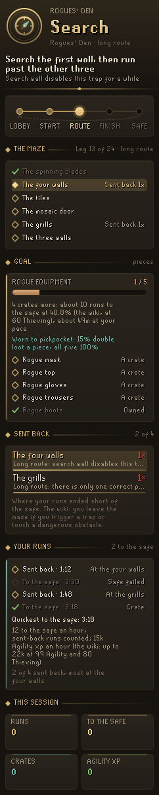
  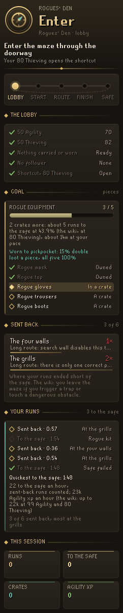
</p>
<p align="center">
  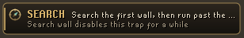
  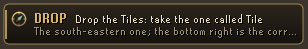
</p>

### Tempoross
- **One step through the storm.** Catch harpoonfish, cook them at the shrine, fill the ammunition crate, and harpoon the spirit pool while Tempoross is down. Each step is lit in the world, the fishing spot, the shrine, the crate or the pool, with its path and a line of why.
- **The double spot first.** When a spot of jumping harpoonfish is up, that is where you fish, even with raw fish still to cook: it can give two a catch, and the wiki's strategies say to fish there wherever possible.
- **Tether before the wave.** When the game calls "A colossal wave closes in...", the next step is the nearest totem pole or mast that is not broken, and nothing else until you are tied on. No rope? It points you to the rope crate, and knows the whole spirit angler outfit counts as one. The tick coach times each tether from the call.
- **Fires in your way, not every fire.** A fire next to your walk to the next step is the step until it is out, if you carry a bucket of water; otherwise the pump. Fires elsewhere are left to the wave.
- **The storm watched.** Energy, essence and storm intensity from the game's own bar, and once the storm passes a level you choose (80% by default) the step is to load what you hold now, as at 100% the wave washes you away and the game's points with it.
- **Points and permits, game by game.** This game's points, the permits they are sure to pay (the first at 2,000, then one every 700) and the chance of one more, the permits you hold, and each game you play kept per account: points, permits (corrected to the game's own count when it pays), time and whether Tempoross was subdued. Across games, permits an hour and your best game.

<p align="center">
  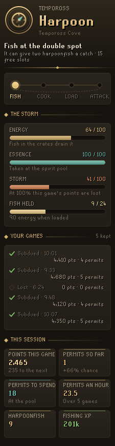
  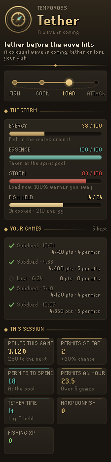
</p>
<p align="center">
  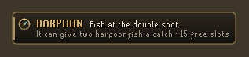
  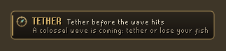
</p>

<p align="center">
  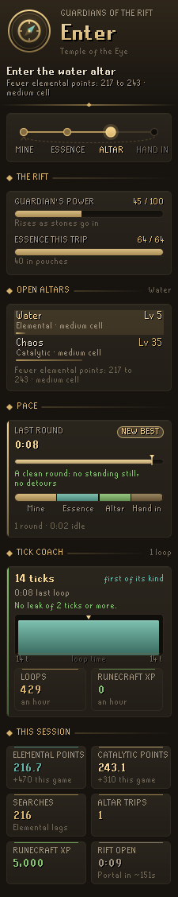
  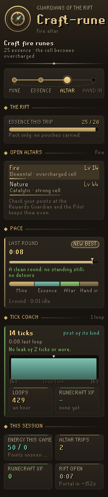
</p>
<p align="center">
  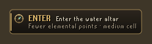
  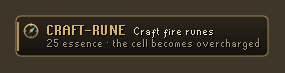
</p>

<p align="center">
  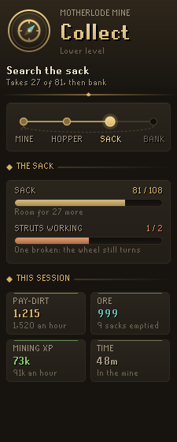
  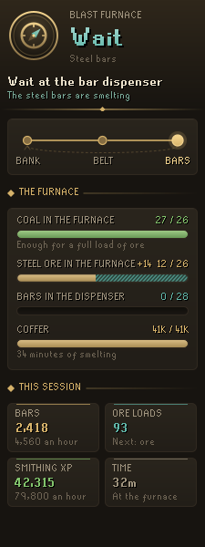
  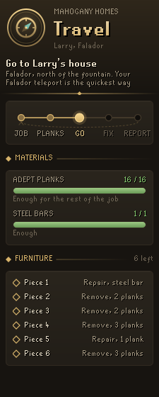
</p>

## In the game view

- The thing to click is filled and outlined in gold, with a small plate naming the action (Deposit, Take, Build).
- The walk there is a trail of teal beads on the ground that brightens toward the end, and the same path on the minimap.
- Items a step names are ringed in the inventory, the worn equipment and the open bank.
- A slim plaque holds the step and its line of why.

<p align="center">
  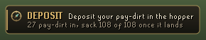
  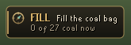
  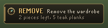
</p>

## The panel

The helm at the top holds the next action as one large gilt word and the full instruction under it, and flares when the step changes. Under it, the minigame's loop with your place in it, its gauges (the sack with pay-dirt in flight, the furnace's coal against what the next load needs, the planks the job still takes), the furniture checklist, and the session so far: pay-dirt, ore, bars, contracts, points and experience, with hourly pace. Away from the minigames it lists them all and what is waiting at each, such as an open contract, and what your last visit to the Motherlode Mine and the Blast Furnace came to: "Last visit 3 hours ago: 1h 12m for 1,134 pay-dirt, 972 ore, 68k Mining xp and ore worth 142k."

Each minigame's card also keeps your best visit, the most pay-dirt or bars an hour over at least fifteen minutes, with its experience an hour: "Best visit 5 days ago: 1,620 pay-dirt and 81k Mining xp an hour over 1h 24m." It is kept per account, and a session never carries over to another account.

When you walk out of the Motherlode Mine or the Blast Furnace after a session of five minutes or more, a line in the chat says what it came to, and when it beat your best visit from another day, by how much ("A new best: 1,620 pay-dirt an hour, up from 1,512."). Logging in, or hopping, starts every count from what the game shows once it has settled, so a pack that reads empty for a tick and then full is never counted as a haul, and experience is only counted once your skills have arrived.

## Pace coach

Every time the loop comes back to its start (a load of pay-dirt in the hopper, a trip to the furnace, a finished contract) the round is timed and compared with your best round of the same kind. The panel shows the time, how far it was over or under your best, and the one thing that cost the most: ticks spent standing still with something to do (the bank, dialogue and menus don't count) or tiles walked beyond the shortest way. Your bests are kept per account, so they carry over to the next session. Rounds with a break in them are left out.

Each round is also split into the stages of its loop (Mine, Hopper, Sack, Bank; Bank, Belt, Bars; Job, Planks, Go, Fix, Report), drawn as one bar in proportion to the time each stage took. Every stage keeps its own best, so even a slow round can set a best bank trip. The stage that lost the most against its best is lit in ember and named: "Bank took 0:29, 0:10 over your best for it".

<p align="center">
  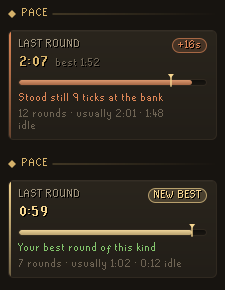
</p>

## Tick coach

The game runs on 0.6-second ticks, and the tick coach counts every loop in them: Motherlode's mine, hopper, sack and bank; the Blast Furnace's bank, belt and bars; a Mahogany Homes contract from the contractor through the furniture and back; a Guardians of the Rift altar trip from mining through essence and the altar to handing in; a Tempoross round from fishing through the shrine and the crate (and the spirit pool, when Tempoross goes down) back to fishing; a Giants' Foundry sword from the commission to the hand-in; a Mastering Mixology round from one delivery to the next; a Vale totem from the build through the carvings and decorations to the offerings. After each loop the panel shows:

- **The loop in ticks against your best** of the same kind ("176 ticks, +26 on best"), or "new best".
- **Its walking against a floor.** Every walk the Pilot sends you on is measured over the game's collision map, so its shortest way is known; at run pace (two tiles a tick) that walk has a floor nobody can beat. The card sets the ticks you spent on foot against it: "On foot 19 ticks against a floor of 17 at run pace, 2 over". Mining, smelting and building have no fixed duration the wiki states, so the coach never invents a floor for them: those parts are only compared with your own best.
- **The single biggest leak**, named and placed: "idle 7 ticks at the sack" (standing still with something to do; the bank, dialogue and menus don't count) or "11 ticks lost on foot to the belt" (a detour, or walking where you could run). When neither cost two ticks or more, the stage furthest over its own best stands in.
- **Loops an hour and experience an hour** while looping, from the loops themselves, so a break never drags them down.
- **A histogram of your loop times**, the bar holding the last loop lit in teal and a gilt pennant over your best.

Loops with a break in them are left out, as in the pace coach. It is stats only: it changes nothing about the guidance, and can be turned off under *Tick coach*.

<p align="center">
  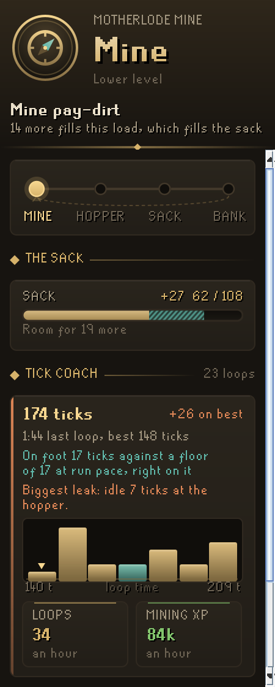
</p>

## Goals

Each minigame works toward something, chosen in the settings: a reward from its shop or a level.

- **Motherlode Mine** saves nuggets for the prospector kit, the coal bag, the gem bag or the bigger sack. Next reward walks that order and picks the first set you have not finished.
- **Mahogany Homes** saves points for the plank sack, the carpenter's outfit, Amy's saw or the Hosidius blueprints, and counts the contracts left at your tier.
- **Blast Furnace** has no shop, so its goal is a Smithing level, the next one unless you pick another.

Pieces you already own are ticked off wherever they are: carried, worn, or in your bank as it was the last time you opened it. Nuggets in the bank count toward the total. Your Mahogany Homes points are read from the message after each contract. The card shows how much is left, what that comes to in contracts and time at the pace you have kept this session, and lights any piece you can already pay for. Once every reward is owned, the goal moves to the next level. Away from the minigames, the panel lists every goal at once.

Whether that message's total is what you can spend or everything you have ever earned, the Pilot works out as you play rather than guessing. A total that drops can only be a balance; so can a total smaller than what the rewards you own cost. Buy a reward between two contracts and the next total settles it: a balance falls by the price, a lifetime total keeps climbing by a contract's few points. A reward counts as bought only when it turns up in your pack at the reward shop, from nowhere you had it (not carried, worn or in the bank a moment ago). A carpenter's piece taken out of group storage or your house's costume room is not a purchase. A reward you have once carried, worn or banked stays counted as owned after you store it in the costume room, so the goal card does not ask you to buy it again; one only borrowed from group storage is not remembered as yours. Until it is settled, the card takes the lower of the two readings, so it never lights a reward you cannot afford yet.

**Reward road.** In the Motherlode Mine and at Mahogany Homes the panel lays the whole reward shop out as a road (at the Blast Furnace, which has no shop, the road is the Smithing levels that open each bar), in the order players usually buy: a column of medallions, each holding the reward's own item, joined by a gilt thread that is solid as far as you own and dotted beyond. Owned rewards are rimmed in gold and ticked. The next one is ringed by how much of it you already hold and says what is left ("36 to go, 1h 43m"); the ones after it say what they cost and when they are yours at your pace, the stops before them counted first ("100 nuggets, in 6h 29m", or "500 points, in 472 contracts" before there is an hourly pace). Anything you can already pay for is lit gold. If a Codex Navigator goal needs a higher level in the minigame's skill, the road ends on that level, timed at your experience an hour, with a line naming the goal. It can be turned off under Goals.

A gauge never reads full while you are short: 9,600 nuggets of 10,000 reads "9k / 10k", not "10k / 10k".

<p align="center">
  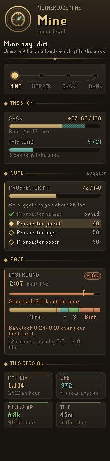
  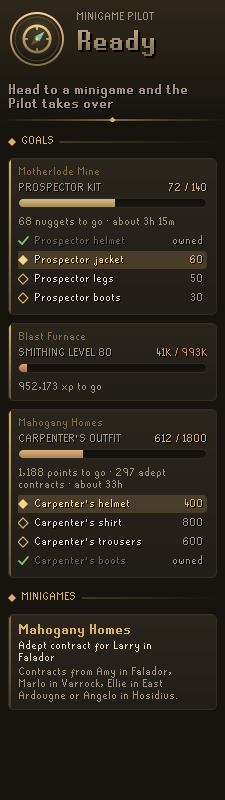
  
  
</p>

## What pays at the Blast Furnace

At the furnace the panel ranks every bar by what it makes at today's Grand Exchange prices: the bar's price less its ore and the coal it burns. Coal trips are counted in, since a bar that burns more coal than the coal bag brings along needs extra trips (half a trip a load for mithril with the bag, one and a half for runite), so a richer bar can still make less an hour. Once a few trips are timed it turns into coins and experience an hour at your own trip time, after the coffer and, under level 60, the foreman. The bar you are making is lit, bars your level does not reach yet are dimmed at the bottom, and a loss is shown in red. Goldsmith gauntlets are counted for gold.

<p align="center">
  
</p>

<sub>The picture is drawn with example prices, not live ones. In game every figure comes from the Grand Exchange prices RuneLite has at the time, so the order of the bars moves with the market.</sub>

## Works with other Codex plugins

All are read only, never written, and everything works without them.

- **[Codex Bank Steward](https://github.com/Nubles/OSRS-Codex-Bank-Steward):** its shared snapshot of your bank (`bankV1`) gives the supply counts (ore, coal, planks, steel bars) from the first login, before you open the bank with the Pilot on. The newer of its snapshot and the Pilot's own last look is used, and the card says which and how long ago.
- **[Codex Wayfinder](https://github.com/Nubles/osrs-codex-wayfinder):** its shared atlas (`atlasV1`) of the teleports this account owns, where each lands and your walking pace, for the quickest way to a Mahogany Homes client.
- **[Codex Navigator](https://github.com/Nubles/OSRS-Codex-Navigator):** its goal board (`goalBoard`). A level goal the Pilot picks (the Blast Furnace level left at 0, or Next level and Next reward once the rewards are owned) follows the level your pinned goals need, your focus goal's first, and the card names it: "Dragon Slayer II needs Smithing 70". The reward road ends on that level.

## Your data

Your bank's goal items and supplies as last seen, your Mahogany Homes points, your Guardians of the Rift points, your last thirty Tempoross games, your last fifty Giants' Foundry swords and the moulds the jig has shown you own, your last hundred Mastering Mixology deliveries, your last hundred Vale totems with where each totem site stands and the order you visit them, your last hundred Tithe Farm sacks and the order you plant your round in, your last two hundred artefact trips with where each house's drawers and Captain Khaled were seen, your last two hundred house hauls with where each house's door and Oriana were seen and what Oriana pays you a valuable, your last fifty Mahogany Homes contracts, the rewards you own, your round bests, your last and best visit to each minigame and what your contracts take are saved in your RuneLite profile, per account. A damaged or hand-edited value is read as far as it can be and the rest left out, so it never stops the Pilot.

## Field notes

An optional setting, **Keep field notes**, writes a plain record of what the Pilot saw and decided to the plugin's own data folder, `.runelite/plugin-data/codex-minigame-pilot/`, while you are in a minigame: each step it chose, any target it could not find, the minigame's varbits, game messages, your clicks, objects and characters nearby (with whether the Pilot was tracking them), and each timed round. It is for checking the guidance against real play. It is off unless you turn it on, it stays on your computer, and nothing is sent anywhere.

## Rules posture

Codex Minigame Pilot is guidance only. It reads what the game already shows you (your inventory, worn items, the bank when open, the minigames' own counters, and objects and characters in view) and draws on top. It does not click, type, change menus or send anything over the network. Field notes, when turned on, are only written to a local file. It gives no combat or boss advice.

## Settings that matter

- **Minigames:** turn each of the eleven off; *Mark patrols* for stealing artefacts; *Mark homeowners* for stealing valuables; *Tithe plants a round* for the Tithe Farm; *Vale totem wood* and *Claim offerings as you pass* for Vale Totems; *Mixology orders to make* (every order, or the most resin per paste) and *Mixology station cues*; *Cook before loading* and *Load what you hold at storm* (80%) for Tempoross; *Fragments before first craft* for Guardians of the Rift (120 by default); fix the *Blast Furnace bar* instead of letting the Pilot work it out; *Top up coffer below* (2,500 coins by default).
- **Guidance:** *Step plaque*, *Path on the ground*, *Path on minimap*, *Action labels*, *Mark what comes after*, *Hint arrow*, *World map marker* and *Low planks in chat* for Mahogany Homes, and *Visit summary in chat*. All on by default.
- **Goals:** what Motherlode nuggets and Mahogany Homes points are saved for, the *Mixology reward* your resin is saved for, the *Vale Totems reward* your research points are saved for, the *Tithe Farm reward* your points are saved for, the *Stealing artefacts level* and *Stealing valuables level* (0 for the next), the *Blast Furnace level* to work toward (0 for the next), *Show goals* and *Reward road*.
- **Tick coach:** *Tick coach*, on by default.
- **Field notes:** *Keep field notes*, off by default.

## Development

```bash
./gradlew build   # compile and run tests
./gradlew run     # launch RuneLite with the plugin loaded
```

The planners and the walking-distance search (`core/`) are plain Java with unit tests. `pilot/` reads the game and picks targets, and `ui/` and `overlay/` draw.

## Licence

BSD 2-Clause, see [LICENSE](LICENSE).
