# Codex Minigame Pilot

**One clear next step for Motherlode Mine, Blast Furnace and Mahogany Homes.** The Pilot watches the minigame you are in and always shows the single thing to do next: what to click, lit in gold in the world, the path there drawn on the ground and the minimap, and a line on why. You still do every click. It only reads the game and draws.

It is part of the **Codex** suite, alongside [Codex Navigator](https://github.com/Nubles/OSRS-Codex-Navigator), [Codex Guardian](https://github.com/Nubles/OSRS-Codex-Guardian), [Codex Gear Roadmap](https://github.com/Nubles/OSRS-Codex-Gear-Roadmap), [Codex Session Chronicle](https://github.com/Nubles/OSRS-Codex-Session-Chronicle), [Codex Ledger](https://github.com/Nubles/OSRS-Codex-Ledger) and [Codex Quartermaster](https://github.com/Nubles/OSRS-Codex-Quartermaster), and shares their look: warm ink, aged gold and the game's own fonts.

<p align="center">
  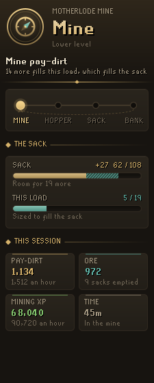
  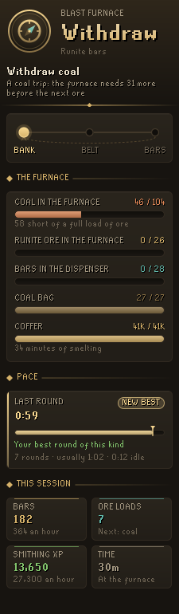
  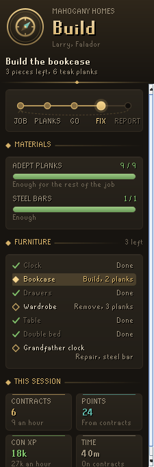
</p>

## What it does

### Motherlode Mine
- **Every load sized to fill the sack.** With 89 pay-dirt in the sack it says to mine 19, not 27 the hopper cannot take. Pay-dirt still washing through the wheel is counted as in flight, so the sack is never overfilled by a load that has not landed yet.
- **Fill, then empty.** It remembers whether you are filling the sack or emptying it, so after banking it sends you back to the sack, not the veins, until the sack is empty.
- **The nearest vein on foot.** Distances are walked over the game's own collision map, so a vein around a corner beats one behind a wall. Veins with another player standing at them count as further away. The next vein after this one is quietly outlined too.
- **Rockfalls and struts.** When the quickest way runs through a rockfall, the step becomes mining it. When both struts are broken and pay-dirt is held up, the step is hammering one.
- **Either level.** It tells the upper and lower levels apart and sends you to the ladder when what you need is on the other.
- **What the sack pays.** Every ore the sack hands you is counted and priced at today's Grand Exchange prices, with coins an hour beside your experience. Only what comes out of the sack counts, not ore taken from the bank. With an open coal bag the sack's coal goes straight into the bag; the sack says how many pieces it gave, so what never reached your pack is counted as coal in the bag.

### Blast Furnace
- **Coal trips worked out ahead.** At the bank it compares the coal in the furnace, plus a full coal bag, with what a load of ore will burn, and calls a coal trip only when the ore would otherwise sit unsmelted. Steel with a coal bag never needs one, mithril needs one every other ore trip, and runite about one and a half to each ore trip.
- **The whole round.** Deposit bars, fill the coal bag, withdraw coal or ore (ringed in the bank), load the belt, empty the coal bag and load again, put on ice gloves while the bars smelt, take them, bank. Gold asks for goldsmith gauntlets before the ore goes on the belt.
- **Coffer watch.** It asks you to top up the coffer before it runs dry, and the panel shows how many minutes of smelting are left.
- **Any bar.** Iron, steel, mithril, adamantite, runite, gold and silver, picked from the ore you carry, the ore in the furnace or the ore in your bank, or chosen in the settings.
- **How far your bank goes.** The ore and coal in your bank, with what you carry, the coal bag and the furnace, turned into bars, trips and time at your own trip pace, and which runs out first: "975 runite bars, 92 trips, about 1h 38m. Coal runs out first: 1,060 more would smelt all the ore".

### Mahogany Homes
- **From contract to points.** Which contractor to ask and for which tier, the planks and steel bars to bring (counted from the job's own furniture, plank sack included), the way to the client's house with a hint arrow and a world map marker, the teleport you carry that gets there quickest, then each piece of furniture in walking order.
- **Floor by floor.** When the rest of the work, or the client, is upstairs, the step is the ladder.
- **A checklist.** Every piece of furniture with what it needs (repair, remove, build) and what it costs, ticked off as you go.
- **What a contract costs you.** Each contract you finish is measured: the Construction experience it gave (any outfit bonus included), the planks and steel the job took, and the whole loop's time. Priced at today's Grand Exchange prices, the tiers you have done are ranked by coins per experience point, with experience an hour, so you can see whether expert contracts are worth their mahogany. Nothing is guessed: a tier is ranked once you have finished one, and a job first seen half done is not measured.
- **Planks in the bank.** Your tier's planks and steel bars in the bank, carried and in the plank sack, counted in contracts at what your own contracts take, and in time: "Mahogany planks for about 24 contracts, 1h 48m". Away from the minigames the Mahogany Homes card says the same.

<p align="center">
  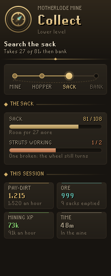
  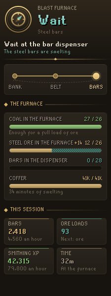
  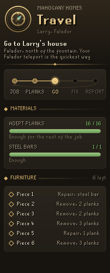
</p>

## In the game view

- The thing to click is filled and outlined in gold, with a small plate naming the action (Deposit, Take, Build).
- The walk there is a trail of teal beads on the ground that brightens toward the end, and the same path on the minimap.
- Items a step names are ringed in the inventory, the worn equipment and the open bank.
- A slim plaque holds the step and its line of why.

<p align="center">
  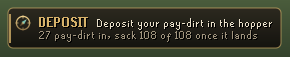
  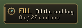
  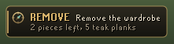
</p>

## The panel

The helm at the top holds the next action as one large gilt word and the full instruction under it, and flares when the step changes. Under it, the minigame's loop with your place in it, its gauges (the sack with pay-dirt in flight, the furnace's coal against what the next load needs, the planks the job still takes), the furniture checklist, and the session so far: pay-dirt, ore, bars, contracts, points and experience, with hourly pace. Away from the minigames it lists all three and what is waiting at each, such as an open contract, and what your last visit to the Motherlode Mine and the Blast Furnace came to: "Last visit 3 hours ago: 1h 12m for 1,134 pay-dirt, 972 ore, 68,040 Mining xp and ore worth 142K."

Each minigame's card also keeps your best visit, the most pay-dirt or bars an hour over at least fifteen minutes, with its experience an hour: "Best visit 5 days ago: 1,620 pay-dirt and 81,000 Mining xp an hour over 1h 24m." It is kept per account, and a session never carries over to another account.

When you walk out of the Motherlode Mine or the Blast Furnace after a session of five minutes or more, a line in the chat says what it came to, and when it beat your best visit from another day, by how much ("A new best: 1,620 pay-dirt an hour, up from 1,512."). Logging in, or hopping, starts every count from what the game shows once it has settled, so a pack that reads empty for a tick and then full is never counted as a haul, and experience is only counted once your skills have arrived.

## Pace coach

Every time the loop comes back to its start (a load of pay-dirt in the hopper, a trip to the furnace, a finished contract) the round is timed and compared with your best round of the same kind. The panel shows the time, how far it was over or under your best, and the one thing that cost the most: ticks spent standing still with something to do (the bank, dialogue and menus don't count) or tiles walked beyond the shortest way. Your bests are kept per account, so they carry over to the next session. Rounds with a break in them are left out.

Each round is also split into the stages of its loop (Mine, Hopper, Sack, Bank; Bank, Belt, Bars; Job, Planks, Go, Fix, Report), drawn as one bar in proportion to the time each stage took. Every stage keeps its own best, so even a slow round can set a best bank trip. The stage that lost the most against its best is lit in ember and named: "Bank took 0:29, 0:10 over your best for it".

<p align="center">
  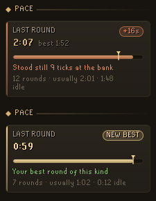
</p>

## Goals

Each minigame works toward something, chosen in the settings: a reward from its shop or a level.

- **Motherlode Mine** saves nuggets for the prospector kit, the coal bag, the gem bag or the bigger sack. Next reward walks that order and picks the first set you have not finished.
- **Mahogany Homes** saves points for the plank sack, the carpenter's outfit, Amy's saw or the Hosidius blueprints, and counts the contracts left at your tier.
- **Blast Furnace** has no shop, so its goal is a Smithing level, the next one unless you pick another.

Pieces you already own are ticked off wherever they are: carried, worn, or in your bank as it was the last time you opened it. Nuggets in the bank count toward the total. Your Mahogany Homes points are read from the message after each contract. The card shows how much is left, what that comes to in contracts and time at the pace you have kept this session, and lights any piece you can already pay for. Once every reward is owned, the goal moves to the next level. Away from the minigames, the panel lists every goal at once.

Whether that message's total is what you can spend or everything you have ever earned, the Pilot works out as you play rather than guessing. A total that drops can only be a balance; so can a total smaller than what the rewards you own cost. Buy a reward between two contracts and the next total settles it: a balance falls by the price, a lifetime total keeps climbing by a contract's few points. A reward counts as bought only when it turns up in your pack at the reward shop, from nowhere you had it (not carried, worn or in the bank a moment ago). A carpenter's piece taken out of group storage or your house's costume room is not a purchase. A reward you have once carried, worn or banked stays counted as owned after you store it in the costume room, so the goal card does not ask you to buy it again; one only borrowed from group storage is not remembered as yours. Until it is settled, the card takes the lower of the two readings, so it never lights a reward you cannot afford yet.

**Reward road.** In the Motherlode Mine and at Mahogany Homes the panel lays the whole reward shop out as a road, in the order players usually buy: a column of medallions, each holding the reward's own item, joined by a gilt thread that is solid as far as you own and dotted beyond. Owned rewards are rimmed in gold and ticked. The next one is ringed by how much of it you already hold and says what is left ("36 to go, 1h 43m"); the ones after it say what they cost and when they are yours at your pace, the stops before them counted first ("100 nuggets, in 6h 29m", or "500 points, in 472 contracts" before there is an hourly pace). Anything you can already pay for is lit gold. If a Codex Navigator goal needs a higher level in the minigame's skill, the road ends on that level, timed at your experience an hour, with a line naming the goal. It can be turned off under Goals.

**With Codex Navigator.** If you use [Codex Navigator](https://github.com/Nubles/OSRS-Codex-Navigator), a level goal the Pilot picks (the Blast Furnace level left at 0, or Next level and Next reward once the rewards are owned) follows the level your pinned goals need: your focus goal's first, otherwise the nearest one up. The card says which goal it is for, such as "Dragon Slayer II needs Smithing 70". Without Navigator nothing changes.

<p align="center">
  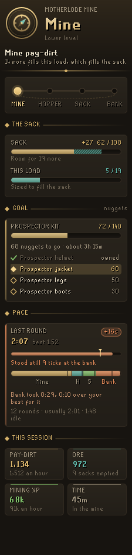
  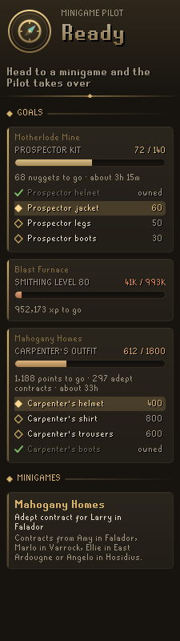
  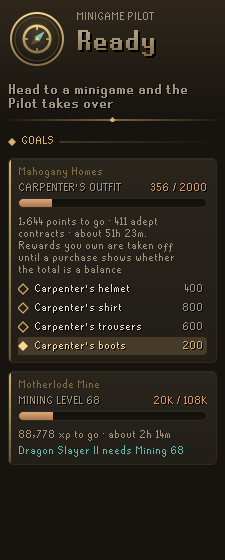
  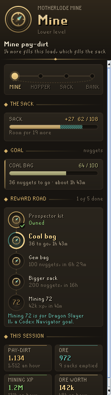
</p>

## What pays at the Blast Furnace

At the furnace the panel ranks every bar by what it makes at today's Grand Exchange prices: the bar's price less its ore and the coal it burns. Coal trips are counted in, since a bar that burns more coal than the coal bag brings along needs extra trips (half a trip a load for mithril with the bag, one and a half for runite), so a richer bar can still make less an hour. Once a few trips are timed it turns into coins and experience an hour at your own trip time, after the coffer and, under level 60, the foreman. The bar you are making is lit, bars your level does not reach yet are dimmed at the bottom, and a loss is shown in red. Goldsmith gauntlets are counted for gold.

<p align="center">
  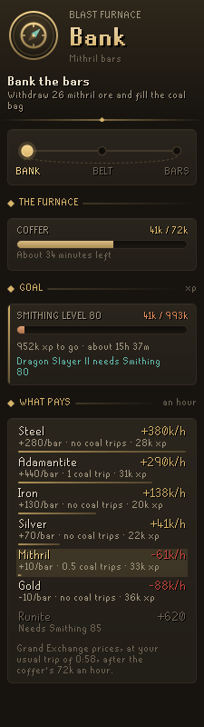
</p>

## Your bank, and Codex Bank Steward

The supply counts come from the bank as the Pilot last saw it. If you use [Codex Bank Steward](https://github.com/Nubles/OSRS-Codex-Bank-Steward), its shared snapshot of your bank is read too, so the counts are there from the first login, before you open the bank; the newer of the two is used, and the card says which and how long ago. Without Bank Steward nothing changes. Potions and other items the minigames do not burn are not kept.

## Field notes

An optional setting, **Keep field notes**, writes a plain record of what the Pilot saw and decided to `.runelite/codex-minigame-pilot/` while you are in a minigame: each step it chose, any target it could not find, the minigame's varbits, game messages, your clicks, objects and characters nearby (with whether the Pilot was tracking them), and each timed round. It is for checking the guidance against real play. It is off unless you turn it on, it stays on your computer, and nothing is sent anywhere.

## Rules posture

Codex Minigame Pilot is guidance only. It reads what the game already shows you (your inventory, worn items, the bank when open, the minigames' own counters, and objects and characters in view) and draws on top. It does not click, type, change menus or send anything over the network. Field notes, when turned on, are only written to a local file. It gives no combat or boss advice.

## Settings

Each minigame can be turned off. The Blast Furnace bar can be fixed instead of worked out, and the coffer warning level set. The plaque, ground path, minimap path, action labels, quieter marks for what comes next, hint arrow, world map marker and the visit summary in the chat can each be turned off. Field notes are under their own section, off by default.

## Development

```bash
./gradlew build   # compile and run tests
./gradlew run     # launch RuneLite with the plugin loaded
```

The planners and the walking-distance search (`core/`) are plain Java with unit tests. `pilot/` reads the game and picks targets, and `ui/` and `overlay/` draw.

## Licence

BSD 2-Clause, see [LICENSE](LICENSE).
